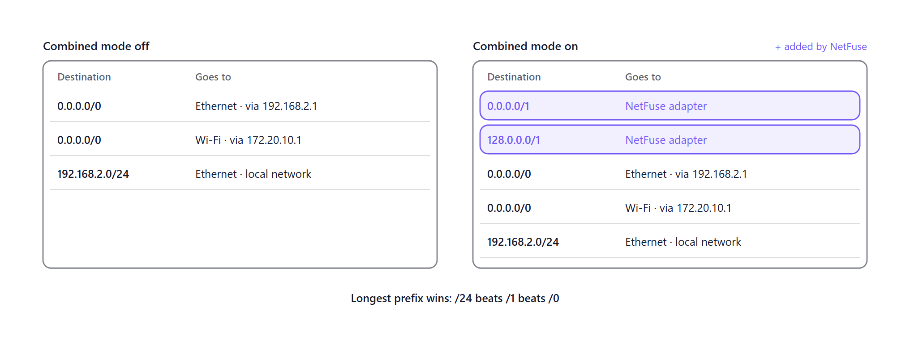
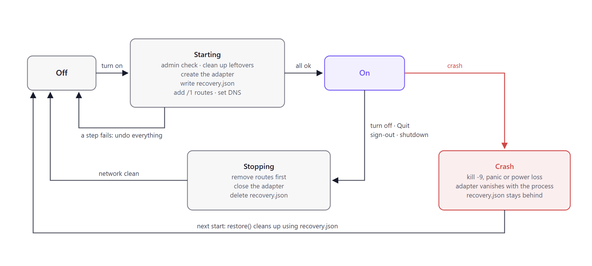
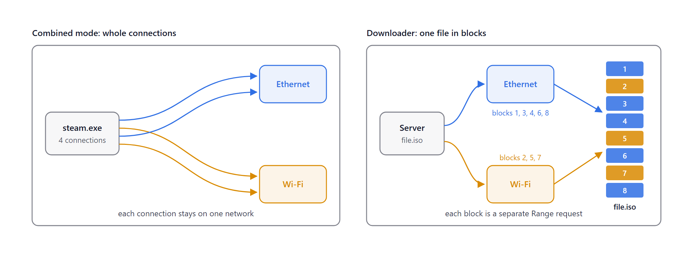

# NetFuse

**Use all your internet connections at once.** Plug in Ethernet, join Wi-Fi, connect
your phone, and NetFuse splits big downloads across all of them, while browsing,
games and calls stay on your main connection.

[](https://github.com/MrTabaOfficial/NetFuse/releases/latest)


NetFuse is free to use. It is closed source: this repository holds the downloads,
documentation, license and security policy, not the source code.

**[Download NetFuse 1.0.0](https://github.com/MrTabaOfficial/NetFuse/releases/latest)** ·
[User guide](docs/USAGE.md) · [Security](SECURITY.md) · [Privacy](PRIVACY.md) ·
[License](LICENSE) · [Changelog](CHANGELOG.md)

## Features

**Combined mode**
- Splits the apps and sites you choose (Steam, Epic, torrent clients, any download
  site) across every connected network.
- Keeps everything else on your main network, so browsing, logins, video calls and
  online games behave exactly as before.
- Spreads each app's connections over the networks that are fastest right now, and
  skips any network that has no internet.
- Sends traffic to your router, NAS or printer through the network it belongs to.

**Rules**
- Boost apps (`steam.exe`), boost sites (`*.steamcontent.com`) and always-main sites.
- Ready-made presets for Steam, Epic Games and torrent clients.
- A "test a connection" box that shows which rule would decide, and why.
- One-click rules from the live connection list: **Boost this app**, **Always main for
  this site**.

**Downloader**
- Fetches one file over all your networks at once, in blocks.
- Pause and resume, also after a restart or a crash.
- **Fix link** for expired download links, keeping the progress.
- Normal, Aggressive and Fixed stream modes, with a limit on connections per server so
  servers aren't overloaded.
- Never mixes old and new parts if the file on the server changes.

**See what's happening**
- Dashboard with a card per network: live speed, latency and data used today.
- A 2-minute speed chart stacked by network.
- Connections screen: every busy connection's app, site, network and route.
- Download details: speed per network and a block map colored by network.

**Control**
- Choose the main network, or follow Windows. Optional fail-over if it goes down.
- Speed limit per network and in total, plus **Slow mode** (2 MB/s).
- Data allowance per network per day, week or month.
- Rename and color your networks; switch any network off for splitting.

**Safe and tidy**
- Never changes your adapters, DNS or default routes; adds two routes only while
  Combined mode is on.
- Cleans up when you turn it off, quit, sign out or shut down, and after a crash.
- **Restore network** in Settings and in the tray menu.
- Tray icon, start with Windows, light and dark theme.
- No telemetry, no accounts, no ads.

> NetFuse helps when your connections are really separate, for example home fibre plus
> a phone. Two adapters on the same router don't add speed.

## Requirements

- Windows 10 or 11, x64
- Administrator rights (Combined mode creates a network adapter and adds routes)
- Two or more internet connections to get a speed-up

## Install

1. Download `NetFuse_1.0.0_x64-setup.exe` (or `NetFuse_1.0.0_x64_en-US.msi`) from the
   [latest release](https://github.com/MrTabaOfficial/NetFuse/releases/latest).
2. Optional but recommended: check the download against `SHA256SUMS.txt` from the same
   release:
   ```powershell
   Get-FileHash .\NetFuse_1.0.0_x64-setup.exe -Algorithm SHA256
   ```
3. Run the installer and accept the license. The installers are not code-signed yet,
   so Windows SmartScreen may say "Windows protected your PC": click **More info**,
   then **Run anyway**. If **Smart App Control** is on, Windows blocks unsigned apps and
   NetFuse can't be installed until it is signed.

## How to use

1. **Start NetFuse** and allow administrator rights. The **Dashboard** shows a card for
   each connected network. The ★ marks your main network; click another card's ★ to
   change it.
2. **Add rules** on the **Rules** screen. The quickest start is a preset (**Steam**,
   **Epic** or **Torrent**), or add an app such as `steam.exe` under **Boost apps**.
3. **Turn on Combined mode** with the big switch on the Dashboard, or from the tray
   menu.
4. **Start your download** in Steam or another boosted app. On **Connections** you see
   its connections marked **Split**, spread across your networks, while everything else
   says **Main**.
5. **For a single big file**, open **Downloads**, click **New download** and paste the
   link. The file is fetched over all networks at once.
6. **When you're done**, turn Combined mode off. Closing the window keeps NetFuse in the
   tray; **Quit** in the tray menu exits and turns Combined mode off.

The [user guide](docs/USAGE.md) explains every screen and setting, the order in which
rules are checked, stream modes and common questions.

## How it stays safe

NetFuse never edits your default routes. Combined mode adds two more specific routes
(`0.0.0.0/1` and `128.0.0.0/1`) that send traffic through NetFuse. Your router stays
reachable directly, and removing the two routes restores the original table exactly.



Every way out of Combined mode leaves the network clean. A normal stop removes the
routes first; after a crash, the adapter disappears with the process and the next start
removes anything left.



## What can and can't be split

Combined mode spreads **whole connections** across networks. A single connection always
stays on one network, because servers see a connection's address and would drop it if
that changed. Apps that open many connections at once, like Steam, get faster. The
built-in downloader goes further and splits **one file** into blocks fetched over
different networks.



## If the internet stops working

1. Turn Combined mode off, or use **Restore network** in Settings or the tray menu.
2. Quit NetFuse from the tray menu.
3. In an administrator PowerShell (removes only NetFuse's routes):
   ```powershell
   Get-NetRoute -InterfaceAlias NetFuse -ErrorAction SilentlyContinue | Remove-NetRoute -Confirm:$false
   ```
4. Restart the computer. NetFuse's adapter only exists while NetFuse runs.

## Support

- **Bugs and questions:** open an
  [issue](https://github.com/MrTabaOfficial/NetFuse/issues/new/choose). Include your
  Windows version, your networks (for example Ethernet + iPhone hotspot) and the log
  from Settings > Logs.
- **Security problems:** please
  [report them privately](https://github.com/MrTabaOfficial/NetFuse/security/advisories/new),
  as described in [SECURITY.md](SECURITY.md). Don't open a public issue.

## License

NetFuse is proprietary freeware: free for anyone to use, personal or commercial, on any
number of devices. Selling it, modifying it, reverse engineering it or removing its
notices is not allowed. See the [license](LICENSE) for the full terms.

Copyright (c) 2026 MrTabaOfficial. All rights reserved.

NetFuse includes open-source components and the Wintun driver, each under its own
license, listed in [THIRD-PARTY-NOTICES.txt](THIRD-PARTY-NOTICES.txt).
